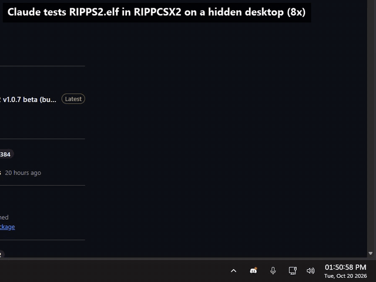
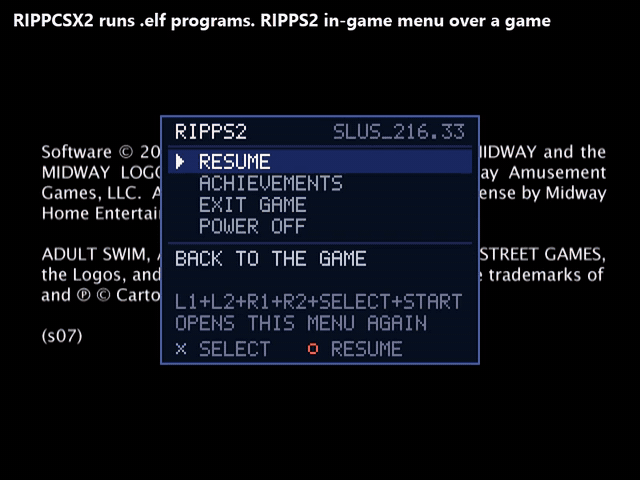
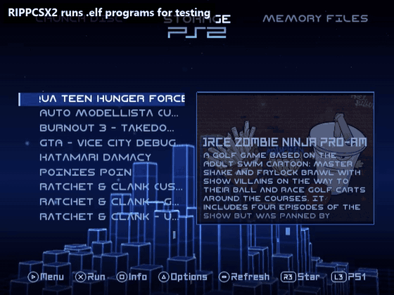

<a href="https://github.com/akilluminati47/RIPPS2">RIPPS2</a> &nbsp;&middot;&nbsp; <a href="https://github.com/akilluminati47/RIPPS2/releases/latest/download/RIPPS2.elf">Download</a> &nbsp;&middot;&nbsp; <a href="https://github.com/akilluminati47/BIBLE">BIBLE</a> &nbsp;&middot;&nbsp; <a href="https://github.com/akilluminati47/RIPPS2-themes">Themes</a> &nbsp;&middot;&nbsp; <b>RIPPCSX2</b> &nbsp;&middot;&nbsp; <a href="https://github.com/akilluminati47/RIPPS2-fonts">Fonts</a> &nbsp;&middot;&nbsp; <a href="https://akilluminati47.github.io/RIPPS2/">Website</a> &nbsp;&middot;&nbsp; <a href="https://www.psx-place.com/threads/ripps2-a-ps2-front-end-in-one-elf-launch-disc-storage-memory-files.51316/">psx-place</a> &nbsp;&middot;&nbsp; <a href="https://discord.gg/ggkCDWqhE">Discord</a>

# RIPPCSX2

**A PlayStation 2 emulator for homebrew testing and development, made to be driven by you or by an AI agent.**

RIPPCSX2 is PCSX2 v2.9.96 with the changes a PS2 homebrew developer needs to see the real thing: HD video modes
shown, captured and screenshotted the way an HDTV shows them, and the EE's hardware data breakpoint, so in-game
menus and video mode tools that hook the GS registers (Open PS2 Loader's GSM, RIPPS2's in-game menu) work as they
do on a console. Everything else is plain PCSX2. It began as the test lab of the
[RIPPS2](https://github.com/akilluminati47/RIPPS2) front end and is meant for anyone building PS2 homebrew, themes or
tools.

### [Download the latest release](https://github.com/akilluminati47/RIPPCSX2/releases/latest)

Windows 10 or 11, x64, a CPU with AVX2. Unzip it anywhere, start `pcsx2-qtx64-avx2.exe`, point it at your own
BIOS dump. An empty `portable.txt` beside the exe keeps all settings and files in that folder.

**It runs `.elf` programs for testing:** System > Start File, or `pcsx2-qtx64-avx2.exe -fastboot -elf <your.elf>`,
and the program boots as it would from a memory card or USB stick on a PS2. It **behaves like real hardware**: an ELF
that launches another ELF hands the machine over and is gone, an in-game menu that hooks the GS draws over the
game's real frame, and a power off closes the VM like a console switching off.

## See it work

Each clip is a real lab run on this build, cut to under 12 seconds.

**An AI agent testing an ELF.** Recorded from the bottom right of the user's screen (taskbar, part of the Claude
session): Claude starts `RIPPS2.elf` in RIPPCSX2 on a hidden desktop, launches Aqua Teen Hunger Force from the HDD image and opens
RIPPS2's in-game menu over it. The small panel is the only thing on screen; the user keeps the keyboard and mouse.

**The in-game menu, every function.** L1+L2+R1+R2+SELECT+START over a running game: ACHIEVEMENTS, RESUME (the
game plays on), the menu again over a later frame, then POWER OFF, which closes the VM. The menu knows which
frame to draw over because RIPPCSX2 emulates the EE's data write breakpoint.

**An ELF launching an ELF, like a real PS2.** RIPPS2's Memory Files opens `mc0:/RIPPS2/RIPPS2.ELF` (the newest
build, copied to the card) and runs it. The running RIPPS2 hands over and is gone; the new one loads from the card
and boots to its game list.

## What you get over vanilla PCSX2 v2.9.96

- **HD modes look right.** 720p and 1080i are shown 16:9 (stock draws them 4:3), in every aspect setting except
  Stretch.
- **HD captures and screenshots.** F11 records 720p at 1280 x 720 and 1080i at 1920 x 1080 (or that times the
  upscale), tagged 16:9; F8 saves screenshots at the same sizes. Stock gives 640 x 480 or the raw 640-wide buffer.
- **A mode switch mid-recording** carries on in a new file at the new size, instead of squeezing into the first.
- **1080i in the right place.** Stock moves a 1080i picture up 42 lines (top cut off, black band below); RIPPCSX2
  starts it at line 40, where the console's own timing does.
- **EE data write breakpoint** (new in rippcsx2.2). COP0 `$24` (`MTBPC`, `MTDAB`, `MTDABM` ...) works: a store to a watched address raises the level 2
  debug exception at `0x80000100` before it executes, in the interpreter and the recompiler. OPL GSM and RIPPS2's
  in-game menu need it to learn which frame a game shows.
- **Video mode log lines.** Every mode change logs the sync timing and display registers
  (`RIPPCSX2: video mode ...` in `logs/emulog.txt`).
- **No auto updater offers.** Release tags keep PCSX2's updater off, so it never "updates" you back to stock.
- Standard definition is untouched: 480i screenshots are byte for byte the same as stock's. `HDTVOutput = false`
  under `[EmuCore/GS]` in `inis/PCSX2.ini` brings back stock HD behaviour for a side by side.

## What it is for

- **Theme makers** (Open PS2 Loader, RiptOPL, RIPPS2): judge a theme in 720p and 1080i as a TV shows it, and make
  true-size previews and walkthrough videos.
- **Homebrew developers:** test ELFs that switch video modes, hook the GS or use the EE's debug registers, and read
  the log for the exact display registers a mode sets.
- **In-game menus and GS tools:** OPL GSM, RIPPS2's in-game menu and anything else built on the data write
  breakpoint run in the emulator instead of only on hardware.
- **Automated and AI-assisted testing:** scripted runs on a hidden desktop with screenshots, captures, save states
  and PINE memory reads, without taking over your PC.

## For AI agents, LLMs and their users

This repo is written so an agent can set a user up from the link alone. Give your assistant
`https://github.com/akilluminati47/RIPPCSX2` and ask it to install RIPPCSX2; everything it needs is here:

1. **Get the build:** the newest `RIPPCSX2-*-windows-x64-avx2.zip` from
   [releases/latest](https://github.com/akilluminati47/RIPPCSX2/releases/latest)
   (`gh release download -R akilluminati47/RIPPCSX2 -p "*.zip"`). Unzip it into a folder of its own and add an
   empty `portable.txt` beside the exe.
2. **BIOS:** the user supplies their own console's BIOS dump (never download one): put it in the `bios` folder
   beside the exe (or point `[Folders] Bios` in `inis/PCSX2.ini` at it) and pick it in the first-run wizard
   (`[Filenames] BIOS`).
3. **Run something:** `pcsx2-qtx64-avx2.exe -fastboot -elf <homebrew.elf>`, or `-- <game.iso>`. Settings are
   plain INI in `inis/PCSX2.ini`; logs go to `logs/emulog.txt` (`[Logging] EnableEEConsole = true` adds the EE's printf).
4. **Drive and observe it:** F8 screenshot (`snaps/`), F11 capture (`videos/`), F1 save state (`sstates/`),
   PINE (`[EmuCore] EnablePINE`, `PINESlot`) to read and write PS2 memory from a script.
5. **Test without stealing the screen:** [`ripps2-lab/`](ripps2-lab/README.md) describes a lab install
   (`install-lab.ps1` puts a build in a portable folder and keeps its cards, settings and captures), and the RIPPS2
   repo's `tools/dev/ps2bg.ps1` runs step lists (buttons, waits, shots, recordings) on a hidden desktop with a
   taskbar panel the user can watch, stop or take over.

What changed and why, file by file: **[RIPPCSX2.md](RIPPCSX2.md)**. Agents working on this fork's code: never open
pull requests, issues or comments on the PCSX2 project (its `AGENTS.md` forbids AI-made contributions); RIPPCSX2
stays a fork.

**Not affiliated with the PCSX2 team.** GPL-3.0 like PCSX2. Report RIPPCSX2 problems to RIPPS2
([issues](https://github.com/akilluminati47/RIPPS2/issues)), never to PCSX2. PCSX2's own README follows.

# PCSX2

PCSX2 is a free and open-source PlayStation 2 (PS2) emulator. Its purpose is to emulate the PS2's hardware, using a combination of MIPS CPU [Interpreters](<https://en.wikipedia.org/wiki/Interpreter_(computing)>), [Recompilers](https://en.wikipedia.org/wiki/Dynamic_recompilation) and a [Virtual Machine](https://en.wikipedia.org/wiki/Virtual_machine) which manages hardware states and PS2 system memory. This allows you to play PS2 games on your PC, with many additional features and benefits.

## Project Details

PCSX2 has been in development for more than 20 years. Past versions could only run a few public domain game demos, but newer versions can run most games at full speed, including popular titles such as Final Fantasy X and Devil May Cry 3. Visit the [PCSX2 compatibility list](https://pcsx2.net/compat/) to check the latest compatibility status of games (with more than 2500 titles tested).

Installers and binaries for both stable and nightly builds are available from [our website](https://pcsx2.net/downloads/).

## System Requirements

PCSX2 supports Windows, Linux, and Mac platforms. Our [setup documentation page](https://pcsx2.net/docs/setup/requirements) contains additional details on software and hardware requirements.

Please note that a BIOS dump from a legitimately-owned PS2 console is required to use the emulator. For more information, visit [this page](https://pcsx2.net/docs/setup/bios/).

## Contributing / Building

PCSX2 supports translation into other languages using [Crowdin](https://crowdin.com/project/pcsx2-emulator).

See the [Contribution Guide](https://pcsx2.net/docs/contributing/) for more info on how to contribute.

<a href="https://github.com/akilluminati47/RIPPS2">RIPPS2</a> &nbsp;&middot;&nbsp; <a href="https://github.com/akilluminati47/RIPPS2/releases/latest/download/RIPPS2.elf">Download</a> &nbsp;&middot;&nbsp; <a href="https://github.com/akilluminati47/BIBLE">BIBLE</a> &nbsp;&middot;&nbsp; <a href="https://github.com/akilluminati47/RIPPS2-themes">Themes</a> &nbsp;&middot;&nbsp; <b>RIPPCSX2</b> &nbsp;&middot;&nbsp; <a href="https://github.com/akilluminati47/RIPPS2-fonts">Fonts</a> &nbsp;&middot;&nbsp; <a href="https://akilluminati47.github.io/RIPPS2/">Website</a> &nbsp;&middot;&nbsp; <a href="https://www.psx-place.com/threads/ripps2-a-ps2-front-end-in-one-elf-launch-disc-storage-memory-files.51316/">psx-place</a> &nbsp;&middot;&nbsp; <a href="https://discord.gg/ggkCDWqhE">Discord</a>

