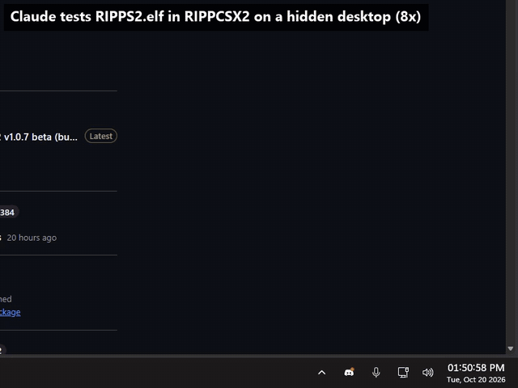
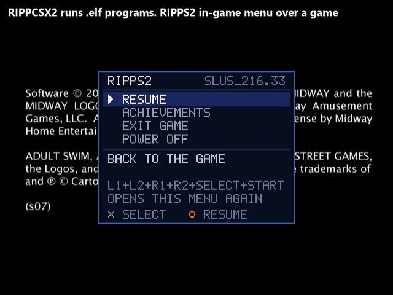
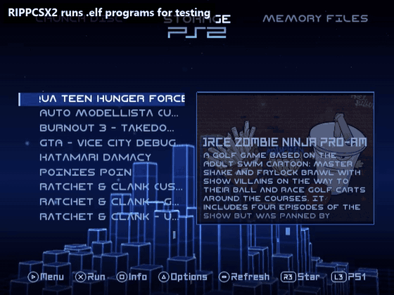

<!-- i18n: the language bar, made by ps2-pillars tools/readme-i18n -->

  <a href="README.md">English</a> |
  <a href="README.es.md">Español</a> |
  <a href="README.pt-BR.md">Português (Brasil)</a> |
  <a href="README.pt.md">Português</a> |
  <a href="README.fr.md">Français</a> |
  <a href="README.de.md">Deutsch</a> |
  <a href="README.it.md">Italiano</a> |
  <a href="README.nl.md">Nederlands</a> |
  <a href="README.da.md">Dansk</a> |
  <a href="README.sv.md">Svenska</a> |
  <a href="README.pl.md">Polski</a> |
  <a href="README.cs.md">Čeština</a> |
  <a href="README.hr.md">Hrvatski</a> |
  <a href="README.sr.md">Srpski</a> |
  <a href="README.bg.md">Български</a> |
  <b>Русский</b> |
  <a href="README.el.md">Ελληνικά</a> |
  <a href="README.hu.md">Magyar</a> |
  <a href="README.ro.md">Română</a> |
  <a href="README.gl.md">Galego</a> |
  <a href="README.sq.md">Shqip</a> |
  <a href="README.tr.md">Türkçe</a> |
  <a href="README.ar.md">العربية</a> |
  <a href="README.fa.md">فارسی</a> |
  <a href="README.ja.md">日本語</a> |
  <a href="README.ko.md">한국어</a> |
  <a href="README.zh-CN.md">简体中文</a> |
  <a href="README.zh-TW.md">繁體中文</a> |
  <a href="README.vi.md">Tiếng Việt</a> |
  <a href="README.lo.md">ລາວ</a> |
  <a href="README.id.md">Bahasa Indonesia</a> |
  <a href="README.fil.md">Filipino</a> |
  <a href="README.ceb.md">Cebuano</a>

<!-- /i18n -->

Перевод английского README; при расхождениях верен английский. <a href="README.md">English</a>

<a href="https://github.com/akilluminati47/RIPPS2">RIPPS2</a> &nbsp;&middot;&nbsp; <a href="https://github.com/akilluminati47/RIPPS2/releases/latest/download/RIPPS2.elf">Скачать</a> &nbsp;&middot;&nbsp; <a href="https://github.com/akilluminati47/BIBLE">BIBLE</a> &nbsp;&middot;&nbsp; <a href="https://github.com/akilluminati47/RIPPS2-themes">Темы</a> &nbsp;&middot;&nbsp; <b>RIPPCSX2</b> &nbsp;&middot;&nbsp; <a href="https://github.com/akilluminati47/RIPPS2-fonts">Шрифты</a> &nbsp;&middot;&nbsp; <a href="https://akilluminati47.github.io/RIPPS2/">Сайт</a> &nbsp;&middot;&nbsp; <a href="https://www.psx-place.com/threads/ripps2-a-ps2-front-end-in-one-elf-launch-disc-storage-memory-files.51316/">psx-place</a> &nbsp;&middot;&nbsp; <a href="https://discord.gg/Z7m9u5kby">Discord</a>

# RIPPCSX2

**Эмулятор PlayStation 2 для тестирования и разработки homebrew, сделанный так, чтобы им управляли вы или ИИ-агент.**

RIPPCSX2 представляет собой PCSX2 v2.9.96 с изменениями, которые нужны разработчику homebrew для PS2, чтобы видеть настоящую картину: видеорежимы HD показываются, записываются и снимаются так, как их показывает HD-телевизор, а аппаратная точка останова по данным EE позволяет внутриигровым меню и инструментам видеорежимов, которые цепляются за регистры GS (GSM из Open PS2 Loader, внутриигровое меню RIPPS2), работать как на консоли. Всё остальное остаётся обычным PCSX2. Он начинался как тестовая лаборатория фронтенда [RIPPS2](https://github.com/akilluminati47/RIPPS2) и предназначен для всех, кто делает homebrew, темы или инструменты для PS2.

**[Посмотреть сайт](https://akilluminati47.github.io/RIPPCSX2/)**: разберите PS2 или взорвите её, а всё о RIPPCSX2 есть в панели Info.

### [Скачать RIPPCSX2 (zip для Windows)](https://github.com/akilluminati47/RIPPCSX2/releases/latest/download/RIPPCSX2-windows-x64-avx2.zip)

Windows 10 или 11, x64, процессор с AVX2. Распакуйте куда угодно, запустите `pcsx2-qtx64-avx2.exe` и укажите собственный дамп BIOS. В zip лежит пустой `portable.txt` рядом с exe, поэтому RIPPCSX2 хранит все настройки и файлы в своей папке: уже установленный PCSX2 сохраняет свои настройки нетронутыми. Релиз всегда содержит самую новую сборку ([его страница](https://github.com/akilluminati47/RIPPCSX2/releases/tag/rolling)); ролики ниже лежат в [docs/videos](docs/videos).

### [Скачать RIPPCSX2 (AppImage для Linux)](https://github.com/akilluminati47/RIPPCSX2/releases/latest/download/RIPPCSX2-linux-x64.AppImage)

x64, процессор с AVX2. Сделайте файл исполняемым и запустите его. Он новый в этом выпуске и собирается тем же процессом, что и zip для Windows, но на машине с Linux ещё не запускался: расскажите, как всё прошло. Кнопка на панели задач для скрытых запусков есть только в Windows.

**Запускает программы `.elf` для тестов:** System > Start File или `pcsx2-qtx64-avx2.exe -fastboot -elf <your.elf>`, и программа загружается так же, как с карты памяти или флешки на PS2. Он **ведёт себя как настоящее железо**: ELF, запускающий другой ELF, передаёт ему машину и исчезает, внутриигровое меню, цепляющееся за GS, рисуется поверх настоящего кадра игры, а выключение закрывает VM, как выключение консоли.

## Посмотрите в работе

Каждый ролик представляет собой настоящий прогон в лаборатории на этой сборке, сокращённый до 12 секунд.

**ИИ-агент тестирует ELF.** Записано в правом нижнем углу экрана пользователя (панель задач, часть сеанса Claude): Claude запускает `RIPPS2.elf` в RIPPCSX2 на скрытом рабочем столе, запускает Aqua Teen Hunger Force с образа HDD и открывает поверх неё внутриигровое меню RIPPS2. Маленькая панель остаётся единственным, что видно на экране; клавиатура и мышь остаются у пользователя.

**Внутриигровое меню, все функции.** L1+L2+R1+R2+SELECT+START поверх идущей игры: ACHIEVEMENTS, RESUME (игра продолжается), снова меню поверх более позднего кадра, затем POWER OFF, которое закрывает VM. Меню знает, поверх какого кадра рисовать, потому что RIPPCSX2 эмулирует точку останова EE по записи данных.

**ELF запускает ELF, как настоящая PS2.** Memory Files в RIPPS2 открывает `mc0:/RIPPS2/RIPPS2.ELF` (самую новую сборку, скопированную на карту) и запускает её. Работающий RIPPS2 передаёт управление и исчезает; новый загружается с карты и стартует в свой список игр.

## Что вы получаете по сравнению с обычным PCSX2 v2.9.96

- **Меню RIPPCSX2** между Debug и Help: Run ELF и Run Last ELF, Lab Monitor в реальном времени, Test Steps, Compatibility Report, переключатели форка и папки, куда всё попадает.
- **RIPART,** в этом меню: база обложек OPL Manager, 16 313 игр, которые читаются диапазонами байтов из её резервной копии на archive.org. Записи игр-приманок, чтобы оценить тему на настоящем списке без игр на диске, список с флажками, где каждую часть обложки игры можно оставить или убрать, поиск игр на диске без обложки и папка ART или `art.tar`, куда всё это сложить. Приманки видны в OPL и RIPPS2 и не запускаются; уже существующий файл никогда не заменяется. akilluminati47 помог этой базе получить 8-битную графику PNG и значки дисков 128 x 128.
- **Обычный OPL запускает игры.** Устройство `host`, которое программа регистрирует сама, теперь получает собственные открытия, поэтому перезагрузка IOP в OPL работает. Оригинал останавливается на `file 'host0:' can't open`.
- **EXIT GAME доходит до браузера.** Прерывание SIO2 терялось при перезагрузке IOP, и OSDSYS ждал карту памяти с чёрным экраном.
- **Кнопка на панели задач для скрытых запусков.** PCSX2, запущенный на скрытом рабочем столе, добавляет кнопку на панель задач, поэтому микшер громкости или мод громкости для приложений достаёт его, как любую другую программу.
- **HD-режимы выглядят правильно.** 720p и 1080i показываются в 16:9 (оригинал рисует их в 4:3), при любой настройке соотношения сторон, кроме Stretch.
- **HD-записи и скриншоты.** F11 записывает 720p в 1280 x 720 и 1080i в 1920 x 1080 (или с учётом масштабирования), с пометкой 16:9; F8 сохраняет скриншоты в тех же размерах. Оригинал даёт 640 x 480 или сырой буфер шириной 640.
- **Смена режима посреди записи** продолжается в новом файле нового размера, а не втискивается в первый.
- **1080i на своём месте.** Оригинал сдвигает картинку 1080i на 42 строки вверх (верх обрезан, внизу чёрная полоса); RIPPCSX2 начинает её со строки 40, как это делает тайминг самой консоли.
- **Точка останова EE по записи данных** (новое в rippcsx2.2). COP0 `$24` (`MTBPC`, `MTDAB`, `MTDABM` ...) работает: запись по отслеживаемому адресу вызывает отладочное исключение уровня 2 по адресу `0x80000100` до её выполнения, и в интерпретаторе, и в рекомпиляторе. GSM из OPL и внутриигровому меню RIPPS2 она нужна, чтобы знать, какой кадр показывает игра.
- **Строки журнала о видеорежиме.** Каждая смена режима записывает тайминг синхронизации и регистры дисплея (`RIPPCSX2: video mode ...` в `logs/emulog.txt`).
- **Никаких предложений автообновления.** Теги релизов держат автообновление PCSX2 выключенным, так что оно никогда не «обновит» вас обратно до оригинала.
- Стандартное разрешение не тронуто: скриншоты в 480i побайтно совпадают с оригинальными. `HDTVOutput = false` в `[EmuCore/GS]` в `inis/PCSX2.ini` возвращает исходное поведение HD для сравнения.

## Для чего он нужен

- **Авторам тем** (Open PS2 Loader, RiptOPL, RIPPS2): оценивайте тему в 720p и 1080i так, как её показывает телевизор, и делайте превью в натуральную величину и видеообзоры.
- **Разработчикам homebrew:** тестируйте ELF, которые меняют видеорежим, цепляются за GS или используют отладочные регистры EE, и смотрите в журнале точные регистры дисплея, которые выставляет режим.
- **Внутриигровым меню и инструментам GS:** GSM из OPL, внутриигровое меню RIPPS2 и всё прочее, построенное на точке останова по записи данных, работают в эмуляторе, а не только на железе.
- **Игры PS1:** запускайте Ember и его игры PS1 с виртуального диска, чтобы проверить запуск и списки PS1, с собственным BIOS PS1 на диске.
- **Автоматизированному и ИИ-тестированию:** скриптовые прогоны на скрытом рабочем столе со скриншотами, записями, сохранёнными состояниями и чтением памяти через PINE, не захватывая ваш ПК.

## Конечная цель: вся библиотека

Самая большая работа впереди: тестировать игры PS2 через собственный путь кода Open PS2 Loader, так, как их запускает консоль, и записывать, что нужно каждой: ELF, KELF, homebrew-приложения и игры в песочнице OPL с автоматическим перебором режимов совместимости. Когда-нибудь кто-то сможет с этим заставить работать всю библиотеку. Это конечная цель RIPPCSX2.

Compatibility Report стал первым шагом: результат игры, использованные режимы OPL и состояние машины, сохранённые в `reports/` как файл и строка в `compatibility.csv`.

## Для ИИ-агентов, LLM и их пользователей

Этот репозиторий написан так, чтобы агент мог всё настроить пользователю по одной лишь ссылке. Дайте своему ассистенту `https://github.com/akilluminati47/RIPPCSX2` и попросите установить RIPPCSX2; всё необходимое есть здесь:

1. **Получите сборку:** `RIPPCSX2-windows-x64-avx2.zip` из непрерывного релиза ([прямая ссылка](https://github.com/akilluminati47/RIPPCSX2/releases/latest/download/RIPPCSX2-windows-x64-avx2.zip) или `gh release download rolling -R akilluminati47/RIPPCSX2 -p "*.zip"`). Распакуйте в отдельную папку; её `portable.txt` уже лежит рядом с exe, так что она никогда не трогает настройки установленного PCSX2.
2. **BIOS:** пользователь предоставляет дамп BIOS собственной консоли (никогда не скачивайте его): положите его в папку `bios` рядом с exe (или направьте на неё `[Folders] Bios` в `inis/PCSX2.ini`) и выберите в мастере первого запуска (`[Filenames] BIOS`).
3. **Запустите что-нибудь:** `pcsx2-qtx64-avx2.exe -fastboot -elf <homebrew.elf>` или `-- <game.iso>`. Настройки хранятся как обычный INI в `inis/PCSX2.ini`; журналы идут в `logs/emulog.txt` (`[Logging] EnableEEConsole = true` добавляет printf от EE).
4. **Управляйте и наблюдайте:** F8 скриншот (`snaps/`), F11 запись (`videos/`), F1 сохранённое состояние (`sstates/`), PINE (`[EmuCore] EnablePINE`, `PINESlot`) для чтения и записи памяти PS2 из скрипта.
5. **Тестируйте, не забирая экран:** [`ripps2-lab/`](ripps2-lab/README.md) описывает лабораторную установку (`install-lab.ps1` кладёт сборку в переносную папку и сохраняет её карты, настройки и записи), а `tools/dev/ps2bg.ps1` из репозитория RIPPS2 выполняет списки шагов (кнопки, ожидания, скриншоты, записи) на скрытом рабочем столе с панелью на панели задач, которую пользователь может смотреть, остановить или перехватить.

Что изменилось и почему, файл за файлом: **[RIPPCSX2.md](RIPPCSX2.md)**. Агенты, работающие над кодом этого форка: никогда не открывайте pull request’ы, issues или комментарии в проекте PCSX2 (его `AGENTS.md` запрещает вклад, сделанный ИИ); RIPPCSX2 остаётся форком.

**Не связан с командой PCSX2.** GPL-3.0, как и PCSX2. Сообщайте о проблемах RIPPCSX2 в RIPPS2 ([issues](https://github.com/akilluminati47/RIPPS2/issues)), никогда в PCSX2. Далее следует собственный README PCSX2.

# PCSX2

PCSX2 является бесплатным эмулятором PlayStation 2 (PS2) с открытым исходным кодом. Его цель состоит в том, чтобы эмулировать железо PS2 с помощью сочетания [Interpreters](<https://en.wikipedia.org/wiki/Interpreter_(computing)>) процессора MIPS, [рекомпиляторов](https://en.wikipedia.org/wiki/Dynamic_recompilation) и [виртуальной машины](https://en.wikipedia.org/wiki/Virtual_machine), которая управляет состояниями железа и системной памятью PS2. Это позволяет играть в игры PS2 на ПК со множеством дополнительных функций и преимуществ.

## Подробности проекта

PCSX2 разрабатывается более 20 лет. Ранние версии могли запускать лишь несколько демо из общественного достояния, а новые запускают большинство игр на полной скорости, включая популярные проекты вроде Final Fantasy X и Devil May Cry 3. Загляните в [список совместимости PCSX2](https://pcsx2.net/compat/), чтобы узнать актуальный статус совместимости игр (протестировано более 2500 тайтлов).

Установщики и бинарные файлы стабильных и ночных сборок доступны на [нашем сайте](https://pcsx2.net/downloads/).

## Системные требования

PCSX2 поддерживает Windows, Linux и Mac. На нашей [странице документации по настройке](https://pcsx2.net/docs/setup/requirements) есть подробности о программных и аппаратных требованиях.

Обратите внимание: для работы эмулятора нужен дамп BIOS с законно приобретённой консоли PS2. Подробнее на [этой странице](https://pcsx2.net/docs/setup/bios/).

## Участие / Сборка

PCSX2 можно переводить на другие языки через [Crowdin](https://crowdin.com/project/pcsx2-emulator).

О том, как внести вклад, читайте в [Руководстве для участников](https://pcsx2.net/docs/contributing/).

<a href="https://github.com/akilluminati47/RIPPS2">RIPPS2</a> &nbsp;&middot;&nbsp; <a href="https://github.com/akilluminati47/RIPPS2/releases/latest/download/RIPPS2.elf">Скачать</a> &nbsp;&middot;&nbsp; <a href="https://github.com/akilluminati47/BIBLE">BIBLE</a> &nbsp;&middot;&nbsp; <a href="https://github.com/akilluminati47/RIPPS2-themes">Темы</a> &nbsp;&middot;&nbsp; <b>RIPPCSX2</b> &nbsp;&middot;&nbsp; <a href="https://github.com/akilluminati47/RIPPS2-fonts">Шрифты</a> &nbsp;&middot;&nbsp; <a href="https://akilluminati47.github.io/RIPPS2/">Сайт</a> &nbsp;&middot;&nbsp; <a href="https://www.psx-place.com/threads/ripps2-a-ps2-front-end-in-one-elf-launch-disc-storage-memory-files.51316/">psx-place</a> &nbsp;&middot;&nbsp; <a href="https://discord.gg/Z7m9u5kby">Discord</a>

